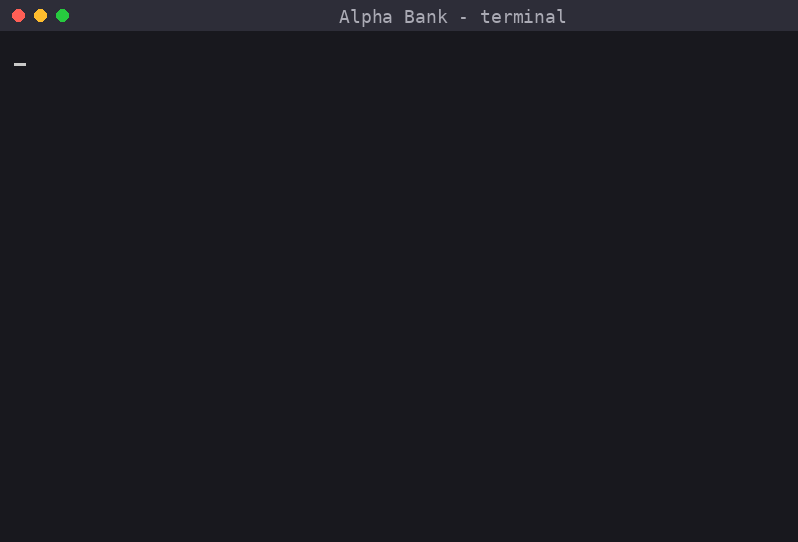
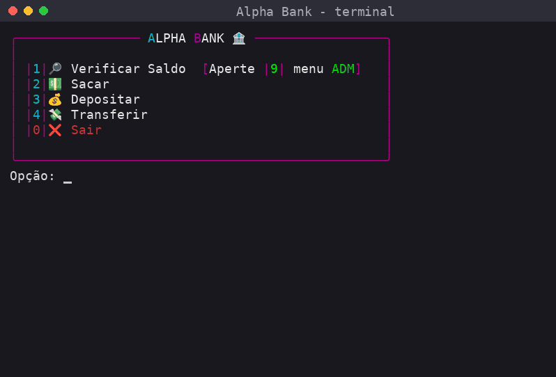

# Alpha Bank 🏦

Um sistema bancário que roda no terminal, feito em Python. Dá pra criar contas, ver saldo, sacar, depositar e transferir entre titulares. Fiz pra praticar orientação a objetos e mexer com arquivos JSON, e aproveitei pra deixar o terminal mais bonito com a biblioteca `rich`.

## Como fica rodando

**Tela inicial**



**Verificar saldo** (a senha fica mascarada com `•`)



**Sacar** (testando erro de letra e valor acima do saldo)


**Depositar**


**Transferir** (testando destinatário que não existe)


**Menu ADM** (cadastrar, listar e remover titular)


## O que tem

- Login por titular e senha de 6 dígitos
- Saldo, saque, depósito e transferência
- Menu de administrador pra cadastrar, listar e remover contas
- Senhas guardadas como hash SHA-256 (nada de senha em texto puro)
- Dados salvos em JSON, o `contas.json` é criado sozinho na primeira vez
- Validação de entrada: letras no lugar de número, valor inválido, titular que não existe etc.
- Animações no terminal (loading, alertas piscando)

## Tecnologias

- Python 3.10+ (uso `match/case`)
- [rich](https://github.com/Textualize/rich) para as cores, painéis, tabelas e animações
- [stdiomask](https://pypi.org/project/stdiomask/) para mascarar a senha
- `json` e `hashlib` da biblioteca padrão

## Como rodar

```bash
git clone <url-do-repositorio>
cd <pasta-do-projeto>
pip install rich stdiomask
python conta_bancaria.py
```

### Criando o admin

O menu ADM (tecla `9` no menu principal) lê o arquivo `admins.json`, que não vem pronto. Crie ele na mesma pasta do programa assim:

```json
[
    {
        "Admin": "Admin",
        "Senha": "8d969eef6ecad3c29a3a629280e686cf0c3f5d5a86aff3ca12020c923adc6c92"
    }
]
```

Esse hash é a senha `123456`. Pra usar outra senha, gera o hash com:

```python
from hashlib import sha256
print(sha256("minha_senha".encode()).hexdigest())
```

## O que eu pratiquei

- Classes, herança (`Titular` herda de `ContaBancaria`) e encapsulamento com atributos privados
- Ler e escrever JSON
- Separar o código em regiões e funções pequenas
- Tratamento de erros com `try/except`
- Fazer o programa funcionar tanto como script quanto como executável (`sys.frozen`)

## O que quero melhorar

Testei o projeto bastante e achei umas coisas que ainda preciso arrumar:

- [ ] Impedir transferência para a própria conta (hoje isso gera saldo do nada)
- [ ] Não deixar abrir o menu ADM quando o `admins.json` está vazio
- [ ] Aceitar senhas que começam com zero (ex: `012345`)
- [ ] Recusar valores como `inf` e `nan` em depósito e saque
- [ ] Avisar quando tentar remover um ID que não existe
- [ ] Usar `bcrypt` ou `argon2` em vez de SHA-256 puro, e limitar tentativas de login
- [ ] Migrar de JSON para banco de dados (PostgreSQL)

## Sobre mim

Sou o Jhon, estudante de Análise e Desenvolvimento de Sistemas na Estácio, focado em Python e buscando meu primeiro estágio em tecnologia. Também tenho interesse em Segurança da Informação.
